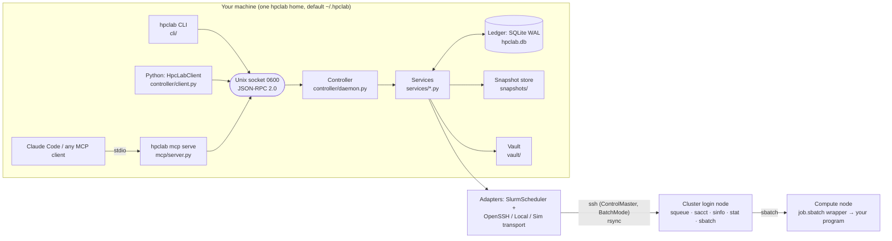
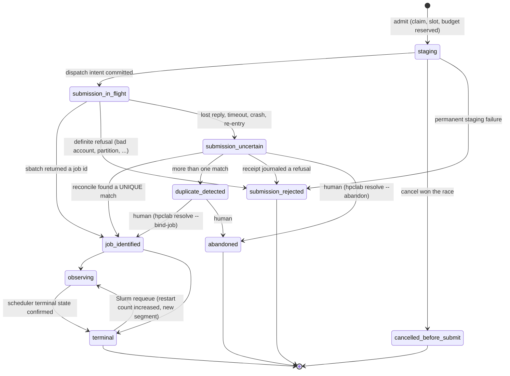

# Architecture

This page is for contributors and for anyone who wants to know *why* HPC Lab can promise what
[guarantees.md](guarantees.md) says it promises. File references are to `src/hpclab/`.

## Components



| Component | Where | What it does |
|---|---|---|
| MCP server | `mcp/server.py`, `mcp/catalog.py` | Thin stdio frontend. Tools, resources and prompts are generated from the catalog and the service registry; every call is forwarded to the controller. No scheduler logic, never prints to stdout (the protocol channel). Reference: [tools.md](tools.md). |
| CLI | `cli/main.py`, `cli/commands.py`, `cli/views.py` | Typer commands calling the same controller methods, with human-readable views. Reference: [cli.md](cli.md). |
| Python client | `controller/client.py` | `HpcLabClient().call(method, params) -> envelope dict`; autostarts the controller, reconnects once on a broken connection. |
| Controller | `controller/daemon.py`, `controller/protocol.py` | One long-lived process per hpclab home; the **single writer** of the ledger. Serves requests, runs the durable outbox workers and the periodic tasks. |
| Services | `services/*.py` | Plain synchronous functions `fn(ctx, *, ...) -> <Name>Data` (Pydantic). They own their SQL, raise typed `HpcLabError`s and never print. `services/app.py` is the method table. |
| Ledger | `storage/schema*.sql`, `storage/db.py` | SQLite in WAL mode on a local disk. Current-state tables plus an append-only `events` log, the `outbox` work queue, `idempotency` records and `budget_reservations`. |
| Adapters | `adapters/` | `Transport` (OpenSSH with ControlMaster, local, simulator) and `SlurmScheduler` (real Slurm command lines, epoch timestamps, delimiter-safe parsing). A single embedded Python helper does remote `stat`/range reads/hashing. |
| Site profiles | `profiles/*.yaml`, `profiles/` package | Public site rules (partitions, storage roles, poll limits, facts and known issues with expiry) + your private overlay (`~/.hpclab/clusters/<id>.yaml`, mode 0600). |
| Job wrapper | `services/jobscript.py` | Renders `job.sbatch`: `#SBATCH` lines plus a bash wrapper that writes `status.json`, `env.json`, `outputs.json` (sha256 computed on the compute node), runs the fail-fast guard and the telemetry sidecar, forwards signals. |
| Simulator | `sim/` | Fake `sbatch squeue sacct scancel sinfo sacctmgr sstat srun scontrol` executables backed by a SQLite state file; jobs run as local processes. The real `SlurmScheduler` runs unmodified against it. Fault injection: `hpclab sim fault`. |

Dependency direction: frontends → services → domain / adapter interfaces. `domain/` imports
neither MCP, SSH nor SQLite. Concrete adapters are injected through `ServiceContext`
(`services/context.py`).

## The controller is the single writer

* **One instance per home.** An exclusive `flock` on `run/controller.lock` for the whole process
  lifetime, plus a pidfile. A stale socket is removed only while holding the lock. The socket
  lives in a 0700 directory with mode 0600 (it falls back to a short per-user `/tmp` path when the
  home path is too long for `AF_UNIX`).
* **Clients are disposable.** The CLI, any number of MCP servers (one per agent session) and
  Python scripts connect to the same socket. The first client autostarts the controller
  (`python -m hpclab.controller --home <home>`, detached, guarded by a spawn lock so two clients
  never race). Closing a chat never stops the bookkeeping.
* **Requests never block for hours.** Each request runs on its own thread with a per-request
  deadline: 90 % of the client's timeout (54 s for an MCP server, 108 s for the CLI with its
  default `--timeout 120`), 55 s when a client sends none, at most 1 h. Past it the caller gets a
  retryable `unavailable` envelope that says whether the work may still complete. A synchronous remote call inside a request is bounded by
  `Settings.request_deadline_s` (20 s). Anything long (staging code, `sbatch`, reconcile,
  downloads, dispatching a matrix) becomes an **Operation** plus outbox items, and the tool
  returns a receipt with `operation_ref` and `poll_after_ms`.
* **Threads.** `controller-server` accepts connections; `worker-N` (2 by default) lease outbox
  items; `controller-scheduler` runs periodic tasks, each on its own thread so a hung `ssh` poll
  cannot starve the others. After a laptop sleep (a forward wall-clock jump) every periodic task
  becomes due at once.
* **Where it runs is where it lives.** If your laptop sleeps, Slurm jobs keep running but new
  dispatch and observation pause until it wakes. Run the controller on an always-on host (a
  workstation you are allowed to use; never the cluster login node) for long sweeps.

### Periodic tasks

| Task | Interval | Owner |
|---|---|---|
| `observe.poll_all` | 5 s tick (the real squeue/sacct rate is capped per cluster by the profile: `poll_min_interval_s`, `sacct_min_interval_s`; HAI: 30 s / 60 s) | `services/observe.py` |
| `submit.reconcile_sweep` | 60 s | `services/submission.py` |
| `workflow.sweep` | 60 s | `services/workflows.py` |
| `artifacts.sweep` | 300 s | `services/artifacts.py` |
| `vault.sweep` | 600 s | `services/vault.py` |
| `notify.flush` | 60 s | `services/notify.py` |
| `cluster.cache_gc`, `usage.cache_gc` | 1 h, 6 h | `services/cluster.py`, `services/usage.py` |
| `controller.renew_leases`, `controller.housekeeping`, `controller.socket_watch` | built in | `controller/daemon.py` |

## Ledger and events

The ledger (`hpclab.db`) is SQLite in WAL mode. It must be on a local disk (never NFS or
scratch: WAL needs one host's shared memory). A controller refuses to start, and a client
refuses to spawn one, when `HPCLAB_HOME` is on a network file system (NFS, SMB, AFS, Lustre,
GPFS, ...); `HPCLAB_ALLOW_NETWORK_HOME=1` overrides that for a home only one machine ever uses.
The pidfile records the host, boot session and process start time, and `hpclab controller
stop` never signals a pid that another machine recorded or that has been reused. Main tables:

`clusters` · `experiments` · `plans` · `runs` · `execution_plans` · `attempts` ·
`attempt_segments` · `operations` · `outbox` · `idempotency` · `events` ·
`budget_reservations` · `workflows` · `workflow_cells` · `artifacts` · `evaluations` ·
`comparisons` · `evidence_bundles` · `observations` · `poll_state` · `notifications` ·
`vault_items` · `report_cache`.

Rules every service follows (the [invariants](../CONTRIBUTING.md#invariants), enforced by tests):

* **Every state change writes an `events` row in the same transaction.** Events carry
  `entity_type/entity_id/entity_version`, `event_type`, a JSON payload, `command_id`,
  `causation_id`, `source` (`api | worker | reconcile | observer | human | migration`),
  `observed_at` and `recorded_at`. `hpclab events --entity <id>` shows them.
* **Transactions are `BEGIN IMMEDIATE`**, so writers serialize and readers never see half a
  command.
* **No network I/O inside a transaction.** The pattern is always *tx (record intent) → network
  call → tx (record outcome)*, and the outcome transaction re-reads the row, so a concurrent
  cancel or a re-entered handler is serialized correctly.
* **Idempotency** is keyed by `(principal, tool, key)` and stores the payload hash and the
  response in the same transaction as the mutation. Same key + same arguments → the stored
  response; same key + other arguments → `idempotency_conflict`.
* **Optimistic concurrency.** Mutations of attempts and workflows take `expected_version`; a
  stale version is `version_conflict` with `details.current_version`. Observation-only
  refreshes (time left, pending reason, last observed) do not bump the version, so a poll does
  not invalidate the version you are about to cancel with.

Real event trail of one attempt whose `sbatch` reply was lost (simulator fault
`sbatch_lose_reply=1`), from `hpclab events --entity att_…`:

```text
attempt.admitted          worker     {"cluster_id": "sim", "exec_plan_hash": "sha256:68745e80…", "gpus": 1, …}
attempt.staged            worker     {"plan_file_sha256": "sha256:75439e6b…", "script_sha256": …}
attempt.dispatching       worker     {"from": "staging", "owner": "alice", "receipt": ".../submit.receipt"}
attempt.uncertain         worker     {"cause": "sbatch", "error": {"code": "unavailable", "details": {"maybe_executed": true, …}}}
attempt.job_identified    reconcile  {"evidence": {"job": {"job_id": "1007", "from_receipt": true, …}}}
attempt.observing         reconcile  {"from": "job_identified", "job_id": "1007", "to": "observing"}
attempt.terminal          observer   {"changes": ["state:UNKNOWN->COMPLETED", …], "exit_code": 0, "source": "sacct"}
attempt.finalized         worker     {"accounting": "ok", "app_state": "exited_ok", "budget": "settled", …}
attempt.result_state_changed worker  {"from": "unchecked", "reason": "artifacts indexed", "to": "valid"}
```

The simulator's ground truth (`hpclab sim jobs`) showed exactly one job with that attempt's token.

## Durable outbox

Long or remote work is a row in `outbox` (`storage/schema.sql`, `services/outbox.py`):

* `pending → leased → done | dead`. A worker leases due rows (`not_before <= now`) with a
  `lease_until`; the controller renews the leases of running items every `lease_s/3`. A crashed
  controller's leases are released at the next start (holding the lock proves it is gone).
* `dedupe_key` is `UNIQUE`, so the same logical step (e.g. `submit.dispatch:<attempt>`) cannot
  be enqueued twice.
* Handlers are **crash-safe and re-entrant**: before a non-idempotent side effect (`sbatch`,
  `scancel`) they commit an intent state, and on re-entry they inspect that state instead of
  repeating the effect.
* Retries: retryable transport errors back off exponentially (cap 300 s, up to ~a day of tries);
  `auth_required` parks the item (retried every 120 s, woken immediately by `hpclab auth
  <cluster>`), unexpected errors are retried a few times and then the item is `dead` and its
  operation `failed`.

| Outbox kind | Payload | Owner |
|---|---|---|
| `prepare.snapshot` | plan | `services/experiments.py` (large snapshots are prepared in the background) |
| `submit.stage`, `submit.dispatch`, `submit.reconcile`, `cancel.execute` | attempt | `services/submission.py` |
| `observe.finalize`, `observe.settle` (late settlement when accounting was missing or unavailable) | attempt | `services/observe.py` |
| `artifacts.index`, `artifact.download` | attempt / artifact | `services/artifacts.py` |
| `evaluation.auto`, `evaluation.collect` | attempt / request | `services/evaluations.py` |
| `vault.capture` | attempt | `services/vault.py` |
| `workflow.dispatch`, `workflow.cancel` | workflow | `services/workflows.py` |
| `notify.send` | notification | `services/notify.py` |

## Entities

```text
Experiment ─┬─ Plan (kind matrix | derived | recovery | probe) ─ ExecutionPlan (resources, snapshot path, profile revision; hashed)
            └─ Run (immutable RunSpec: code digest, argv, params, seed, runtime, outputs; one per matrix cell)
                 └─ Attempt (one execution; retries and resumes are new attempts; own directory)
                      ├─ SchedulerJob (cluster, job id, owner, submit time, restart count; never a global id)
                      ├─ Segments (one per Slurm requeue)
                      └─ Artifact (declared outputs, digest, integrity) → Evaluation → Comparison → Evidence bundle
```

A change to anything scientific (params, argv, code, inputs, runtime) is a new Run with
`derived_from`. A pure resource change (more memory, more time, another node) is a new
ExecutionPlan and Attempt of the same Run. `plan_hash` and `run_spec_hash` are sha256 digests of
canonical JSON, and they travel into the job (`HPCLAB_RUN_SPEC_HASH`) and the checkpoint manifest.

## The attempt state machine

`domain/states.py` (`ATTEMPT_TRANSITIONS`). Any other transition is rejected.



* **Execution claim.** `runs.claim_attempt_id` is set in the same transaction that creates the
  attempt and cleared only in `terminal`, `submission_rejected`, `cancelled_before_submit` or
  `abandoned`. Phases from `staging` to `observing` hold the claim, a concurrency slot and the
  budget reservation. An execution plan is consumed once (`UNIQUE consumed_by_attempt_id`).
* **Uncertain is not failed.** `submission_uncertain` and `duplicate_detected` keep the claim
  and the reservation: a second submission of the same run is refused until the first is
  resolved.
* **Terminal is sticky.** An older or out-of-order observation never moves a terminal attempt
  back to running; only an increased restart count (a Slurm requeue) does, and it opens a new
  `attempt_segments` row instead of overwriting history.

## Submission and reconciliation

```mermaid
sequenceDiagram
    autonumber
    participant C as Agent / CLI
    participant K as Controller (API)
    participant L as Ledger
    participant W as Outbox worker
    participant S as Login node (ssh)
    participant Q as Slurm
    C->>K: run_submit / workflow_submit (idempotency_key)
    K->>L: tx: admit → attempt STAGING, claim, slot, reservation, operation, outbox submit.stage, events, idempotency record
    K-->>C: receipt (attempt_id, operation_ref, poll_after_ms) — not proof of acceptance
    W->>S: submit.stage: rsync snapshot to .staging/, verify, atomic rename, read-only; write job.sbatch + hpclab-plan.json
    W->>L: tx: enqueue submit.dispatch
    W->>S: preflight stat (script, snapshot marker)
    W->>L: tx: phase SUBMISSION_IN_FLIGHT, dispatch_at (the commit happens BEFORE sbatch)
    W->>S: bash: sbatch --parsable; journal rc/stdout/stderr to submit.receipt (tmp + mv); then print
    S->>Q: sbatch
    alt job id parsed
        W->>L: tx: JOB_IDENTIFIED → OBSERVING (job id, owner, submit time)
    else definite refusal
        W->>L: tx: SUBMISSION_REJECTED, release claim + budget
    else lost reply / ambiguous error / crash / re-entry
        W->>L: tx: SUBMISSION_UNCERTAIN, enqueue submit.reconcile
        loop until a unique match, or policy.reconcile_window_s
            W->>S: read submit.receipt
            W->>Q: squeue --user=<me> (all my jobs)
            W->>Q: sacct -u <me> --name=<job name> -S <dispatch_at − skew>
            Note over W: bind only a UNIQUE job with owner = me,<br/>token in job name/comment, submit time ≥ dispatch_at − skew
        end
        W->>L: tx: bind (JOB_IDENTIFIED) | DUPLICATE_DETECTED | operation BLOCKED for a human
    end
    loop observe.poll_all (rate-limited per cluster)
        W->>Q: one squeue for all observed attempts; sacct for those that left the queue
        W->>L: tx: apply observation (identity-checked, ordered by observed_at)
    end
    W->>L: tx: TERMINAL, release claim, enqueue observe.finalize
    W->>S: finalize: status.json, env.json, sacct elapsed → settle budget, diagnosis; then artifacts.index (→ evaluation.auto), vault.capture, workflow.dispatch, notify
```

Details that matter:

* `sbatch` is called **once per attempt, ever**. A handler that finds its attempt already in
  `submission_in_flight` (crash, lease expiry) makes it `submission_uncertain` and reconciles.
* The job name is `hl.<label>.<token[:8]>` and the comment `hpclab:<token>`, so reconcile and
  cancel can recognise the job without trusting a job id.
* Only `SubmissionRejected` (a definite refusal such as `Invalid account`, `invalid partition`,
  `QOSMaxSubmitJobPerUserLimit`) means "nothing was queued". Socket timeouts, "Slurm temporarily
  unable to accept job", empty or garbled output and every transport error after the in-flight
  commit are *uncertain*.
* If reconcile finds nothing before the window closes (`policy.reconcile_window_s +
  policy.accounting_lag_s`: 900 + 120 s on HAI, 120 + 5 s on the simulator) the submit operation
  is `blocked` and the claim and budget stay held. A human decides with
  `hpclab resolve <attempt> --bind-job <id>` (requires a live identity match) or `--abandon`
  (the reservation stays as *unknown*, never released to zero).
* A second job with the same token (e.g. someone re-ran `job.sbatch` by hand) is
  `duplicate_detected`; nothing is cancelled automatically. The wrapper also refuses to run in an
  attempt directory another job already owns (exit 95, `HPCLAB_DUPLICATE_JOB:<job id>`).

## Cancel

`run_cancel` (`services/submission.py`):

* before dispatch → `cancelled_before_submit` at once;
* in flight or uncertain → the intent is recorded and applied after reconciliation;
* identified → `cancel.execute` re-reads the job **live** (`squeue`, then `sacct`) and checks job
  id, owner, the token in the job name (and comment), the submit time against the recorded one
  or the dispatch window, and that the restart count did not go back. Any mismatch →
  `cancel_state = refused` and zero `scancel` calls. Otherwise `scancel`, then `sent` until an
  observation shows a terminal state (`confirmed`).
* Cancel states: `none → requested` (intent recorded) `→ sent` (`scancel` issued after the
  identity check) `→ confirmed`, or `refused` (identity mismatch) / `failed`.
* `mode="request_checkpoint"` sends the declared signal (`scancel --batch --signal=<signal>`,
  `USR1` by default) instead, only for runs declaring
  `resilience.stop_behavior: checkpoint_and_exit`.

## Three state axes

An attempt has three independent axes, plus its lifecycle phase and cancel state:

| Axis | Values | Source |
|---|---|---|
| `scheduler_state` | `PENDING RUNNING COMPLETING COMPLETED FAILED CANCELLED TIMEOUT OUT_OF_MEMORY NODE_FAIL PREEMPTED BOOT_FAIL DEADLINE REQUEUED SUSPENDED … UNKNOWN` | `squeue`, then `sacct` (normalized; raw text kept) |
| `app_state` | `unknown not_started started exited_ok exited_error guard_failed killed` | the wrapper's `status.json` on the cluster |
| `result_state` | `unchecked pending valid incomplete invalid unknown` | `outputs.json` (digests computed on the compute node) + `stat` of every declared output |

`COMPLETED` is not "the results are valid"; exit code 0 is not either; "not in `squeue`" is not
"finished" (if `sacct` has no row yet the attempt gets `observation_gap` and its state is left
alone). A run's summary status (`succeeded`, `completed_unverified`, `failed`, `unknown`, ...)
is derived from its latest attempt.

## Cell codes

`services/coverage.py` is the single function that decides the state of a planned run and which
evaluation counts for it. The grid, `runs_list`, `results_compare`, the evidence export and the
digest all call it, so a grid cell and a paper-table denominator cannot disagree.

| Code | Meaning | In `results_compare` |
|---|---|---|
| `V` | valid: a validated evaluation of an attempt whose outputs are finalized | included |
| `R` | running | missing |
| `Q` | queued (`PENDING`, or identified and awaiting its first observation) | missing |
| `S` | submitting (staging or in flight) | missing |
| `P` | planned, never dispatched | missing |
| `E` | scheduler `COMPLETED`, outputs not known to be bad, no valid evaluation *yet* — not a failure | missing |
| `C!` | `COMPLETED` but the result is bad: outputs incomplete/invalid, or the latest evaluation is partial/invalid | failed |
| `F` | failed: `TIMEOUT`, `OUT_OF_MEMORY`, `NODE_FAIL`, `FAILED`, `PREEMPTED`, ... (the reason is the diagnosis code) | failed |
| `U` | submission uncertain or duplicate detected: do **not** resubmit | missing |
| `X` | cancelled, rejected, abandoned, or a cell of a cancelled workflow that was never dispatched | failed |
| `?` | the last observation is older than the freshness bound: the state *now* is unknown | missing |

`E` resolves by itself (automatic evaluation) or with `evaluation_collect`; if it persists, look
at `run_inspect`.

## Provenance chain

Every number in an evidence bundle carries its chain (`hpclab trace <bundle>:<cell>`, resource
`hpclab://trace/{cell_ref}`):

```text
table cell  \hpcval{evb_…:mixup.acc.mean}{0.842}
  ← comparison cmp_…   (planned run set, contract, statistics; immutable, content-hashed)
  ← per seed: evaluation ev_…   (evaluator id@version, config hash, selected record, split)
  ← artifact art_…   (declared output, sha256 computed on the compute node, integrity finalized)
  ← attempt att_…   (#seq, scheduler COMPLETED, app exited_ok, result valid)
  ← Slurm job   (cluster, job id, owner, submit time)
  ← run run_…   (RunSpec hash: argv, params, seed, runtime, outputs)
  ← code snapshot sha256:…   (+ git commit, dirty-patch digest)
  ← environment   (GPU model, driver, Python, torch/CUDA build, packages digest, from env.json)
```

The code snapshot is content-addressed (identical trees share a digest regardless of the commit),
published to `<remote_root>/snapshots/<hex>/` read-only with a `.hpclab-complete` marker, and
every attempt runs in its own `attempts/<attempt_id>/work/` hardlink farm of it, so edits made
while a job waits in the queue never reach it. The **vault** (`~/.hpclab/vault/<attempt>/`) keeps
local copies of the raw records (the job's `sacct` accounting record, `job.sbatch`, `hpclab-plan.json`,
status/env/outputs JSON, log head and tail, small metrics files) with digests, so the chain
survives a scratch purge.

Remote layout under `remote_root` (e.g. `/hai/scratch/<user>/hpclab`):

```text
snapshots/<hex>/            read-only code snapshot (+ .hpclab-complete, .hpclab-manifest.json)
.staging/<hex>.<publisher>/ temporary upload directory (one per uploading machine)
attempts/<attempt_id>/
  job.sbatch  hpclab-plan.json  submit.receipt
  logs/stdout.log  logs/stderr.log
  status.json  env.json  outputs.json  telemetry/{gpu.csv,heartbeat}
  work/  outputs/  checkpoints/
```

## Trust boundaries

* **You and your code are the principal.** hpclab runs your entrypoint and your
  `runtime.setup` lines (evaluated verbatim) as your Unix user. It is not a sandbox: read-only
  snapshots and content addressing protect against accidents (editing code while a job queues),
  not against your own user.
* **Everything that comes back from the cluster is data**, never instructions: logs, `squeue`
  output, READMEs, manuscript text. They cannot change policy or grant permissions. The MCP
  tools' annotations are UI hints, not authorization; there is no `approved: true` parameter that
  skips a check.
* **The login node gets bounded metadata commands only** (`squeue`, `sacct`, `sinfo`,
  `sacctmgr`, `scontrol show`, `stat`, small range reads, sha256 of files up to
  `max_login_hash_bytes`). Training, checkpoint loading, environment smoke tests and big hashes run
  as Slurm jobs.
* **Authentication stays with you.** hpclab never sees passwords or Duo codes. It runs `ssh` with
  `BatchMode=yes` over a ControlMaster connection that *you* open with `hpclab auth <cluster>`; an
  expired login surfaces as `auth_required` with the exact command to run.
* **Secrets stay out.** Code snapshots exclude credentials (`.env*`, `*.pem`, `*.key`, `id_rsa*`,
  `.netrc`, `.aws/`, `.ssh/`, files containing a PEM private key, ...), data, outputs and
  virtualenvs. Public profiles are linted for personal identifiers; your username and account
  live only in the 0600 overlay. Notifications carry ids, states and labels, never paths, metric
  values or log text; webhook URLs never enter the ledger or logs.
* **Local state is private.** The home is 0700, the socket 0600, overlays 0600. The ledger is
  per user and per machine; several machines writing one ledger is not supported.

See [SECURITY.md](../SECURITY.md) for reporting vulnerabilities.
